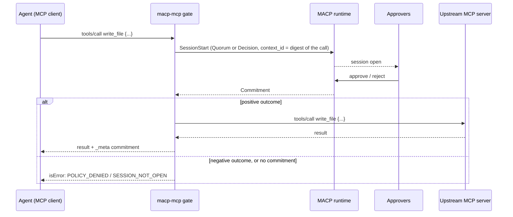

# Gating MCP tool calls with a session

> **Informative.** This note records how the `macp-mcp gate` proxy maps an MCP tool call onto a MACP Coordination Session. It changes nothing in any RFC. Its purpose is to give every implementation of the pattern the same identifiers, so a session opened by one gate can be read and audited by any MACP tool.

## The pattern

An agent calls a tool on an MCP server through a gate. The gate is itself an MCP server that proxies the real (upstream) one. When a call matches one of the gate's rules, the gate opens a session first. It forwards the call only if the session commits a positive outcome. Calls that match no rule pass straight through.



The session is an ordinary Quorum ([RFC-MACP-0011](../rfcs/RFC-MACP-0011-quorum-mode.md)) or Decision ([RFC-MACP-0007](../rfcs/RFC-MACP-0007-decision-mode.md)) session. Its policy, if any, is an ordinary [RFC-MACP-0012](../rfcs/RFC-MACP-0012-policy.md) policy, for example one of the [policy packs](policy-packs.md). Nothing about it is MCP-specific except the three conventions below.

## Conventions

### 1. `context_id` is a digest of the call

`SessionStartPayload.context_id` ([RFC-MACP-0001](../rfcs/RFC-MACP-0001-core.md) Section 7) is `sha256:` followed by the lowercase hex SHA-256 of the RFC 8785 (JCS) canonical JSON of:

```json
{"arguments": {"mode": "w", "path": "/etc/hosts"}, "server": "filesystem", "tool": "write_file"}
```

- `arguments`: the call's arguments object, or `{}` when the call has none.
- `server`: the upstream's name as configured in the gate.
- `tool`: the tool name.

JSON numbers are hashed as RFC 8785 serializes them, which is exact only for integers within ±(2^53−1). The gate refuses a call whose arguments hold a larger integer (see the refusal table below) rather than hash a rounded value the upstream never sees.

For the object above, the canonical bytes are `{"arguments":{"mode":"w","path":"/etc/hosts"},"server":"filesystem","tool":"write_file"}`, and the `context_id` is `sha256:e8272f181497f6286a735f2bd9a2bd535b65e377fc85b6ece9d3a6bac5b73057`.

An approver can recompute the digest from the call it is shown and confirm that the session is about that exact call. An auditor can find every session that gated a given call.

### 2. A forwarded result carries the commitment

When the gate forwards a call, it adds one key to the upstream result's `_meta` and keeps every key the upstream set:

```json
"_meta": {
  "io.multiagentcoordinationprotocol/commitment": {
    "session_id": "…",
    "mode": "macp.mode.quorum.v1",
    "outcome": "…",
    "commitment_hash": "sha256:…"
  }
}
```

`commitment_hash` is the canonical commitment hash of [RFC-MACP-0013](../rfcs/RFC-MACP-0013-commitment-hash.md). Anyone holding the session's Commitment can check it, and it can anchor a decision receipt (RFC-MACP-0013 Appendix A).

### 3. Refusals use registry error codes

A refused call returns an MCP tool error (`isError: true`), and the upstream is never called. The error text starts with a code from [`registries/error-codes.md`](../registries/error-codes.md):

| Situation | Text starts with |
|---|---|
| The session commits a non-positive outcome | `POLICY_DENIED: ` |
| The session expires or is cancelled without a Commitment | `SESSION_NOT_OPEN: ` |
| An argument holds an integer outside ±(2^53−1); no session is opened | `INVALID_ARGUMENT: ` |

## Where the shared contract lives

The gate configuration format and its JSON Schema, the `context_id` test vectors, and the CLI flags live in `contract/gate/` in both [macp-mcp](https://github.com/multiagentcoordinationprotocol/macp-mcp) (Python) and [macp-mcp-typescript](https://github.com/multiagentcoordinationprotocol/macp-mcp-typescript). The two copies are byte-identical. If they disagree with this note, this note is the one to fix.
