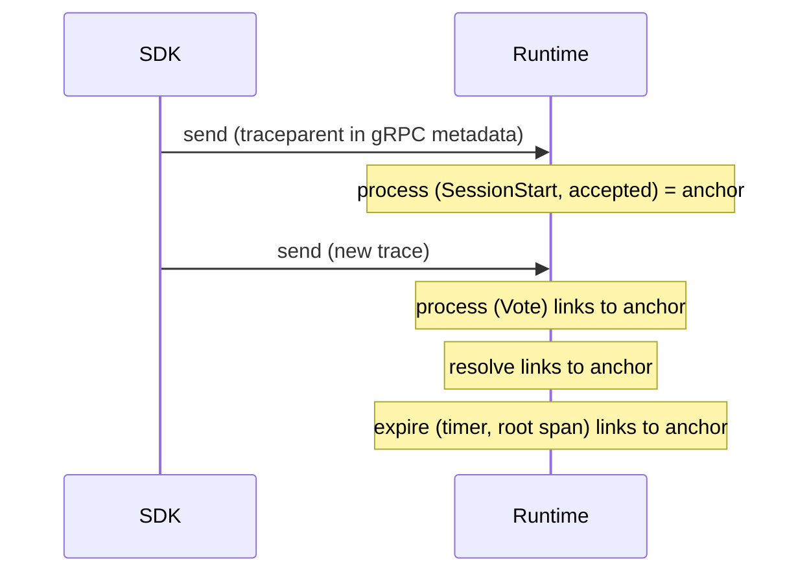

# OpenTelemetry for MACP

> **Status:** Informative. Experimental (`macp-semconv/0.1`). In case of conflict, the referenced RFC is authoritative.
> **Reference:** [`schemas/otel/macp-semconv.json`](../schemas/otel/macp-semconv.json) | [RFC-MACP-0006 §2.1](../rfcs/RFC-MACP-0006-transport-bindings.md#21-trace-context-propagation) | [security.md](security.md#trace-propagation)

This document gives runtimes, control planes and SDKs one set of OpenTelemetry names for MACP:
attributes, spans and metrics, plus the rules for propagating trace context and for keeping
telemetry free of session content. Following it is optional. An implementation that emits MACP
telemetry under these names lets one trace follow an Envelope from the SDK that sent it, through
the runtime that accepted or rejected it, to the session transition it caused.

## The registry file

[`schemas/otel/macp-semconv.json`](../schemas/otel/macp-semconv.json) is the **single list of names**.
This document explains them and does not repeat the list. The file mirrors the
[OpenTelemetry Weaver](https://github.com/open-telemetry/weaver) registry format in JSON:

- `groups[]`, each with `id`, `type` (`attribute_group`, `span` or `metric`), `brief` and `stability`;
- attribute groups define attributes in `attributes[]` with `id`, `type`, `brief`,
  `requirement_level`, `stability` and, for enums, `members`;
- span and metric groups reference attributes with `ref` entries and set the requirement level for
  that use; span groups add `span_kind` and a `span_name` template; metric groups add
  `metric_name`, `instrument` and `unit`;
- OpenTelemetry attributes that MACP reuses rather than redefines (`error.type`, `service.name`,
  `service.version`) appear only as `ref` entries.

The file's top-level `schema` field is the version marker (`macp-semconv/0.1`) and its
[`macp-semconv.schema.json`](../schemas/json/macp-semconv.schema.json) is checked by `make validate`.
SDKs are expected to vendor the file under `tests/otel/` and assert their spans against it.

Every entry is `experimental`. A rename or removal bumps the marker. Adding an attribute, span or
metric does not.

## Attributes

MACP attributes live in the `macp` namespace. They name what is on the wire, with the wire's values:
`macp.message.type` is the Envelope's `message_type` string, `macp.session.state` is the
`SessionState` enum's wire string (for example `SESSION_STATE_RESOLVED`), and `macp.mode.id` is the
mode identifier, such as `macp.mode.decision.v1`. `macp.policy.id` is the resolved policy
identifier bound to the session; there is no separate policy-version attribute, because the
resolved identifier already pins it. `macp.envelope.outcome` is `accepted`, `rejected` or
`duplicate`. `macp.commitment.hash` is the canonical hash of
[RFC-MACP-0013](../rfcs/RFC-MACP-0013-commitment-hash.md), never the commitment itself.

**Implementation-specific attributes** go under `macp.<impl>.*`, where `<impl>` names the
implementation or component, for example `macp.cp.run.id` for a control plane's run identifier.
They are outside this registry and carry no cross-implementation meaning.

**Runtime identity** is the OpenTelemetry resource: `service.name` (for example `macp-runtime`) and
`service.version`. MACP defines no attribute of its own for it.

### Errors and span status

A rejected Envelope is a normal protocol outcome, not a failure of the implementation:

- `error.type` carries the MACPError code from the [error-codes registry](../registries/error-codes.md),
  for example `POLICY_DENIED`, whenever `macp.envelope.outcome` is `rejected`.
- Span status stays UNSET for a rejection. It is ERROR only when the implementation itself failed
  (a storage error, a panic, a transport failure). Then `error.type` follows the OpenTelemetry
  convention for that failure.
- The status description, when set, is the code only. `MACPError.message` and exception messages
  are never recorded (see [Privacy](#privacy)).

## Spans

A span name is `{macp.operation.name} {macp.mode.id}`, for example `process macp.mode.decision.v1`.
When the mode is empty, as for an ambient Signal, the name is the bare operation (`process`). The
message type is an attribute and never part of the name, which keeps span-name cardinality bounded
by the number of modes.

The Envelope's `mode` is chosen by the client, so a runtime fills the name only with a mode it
supports. When an Envelope names a mode the runtime does not support, which it always rejects
(`MODE_NOT_SUPPORTED`), the name is `{macp.operation.name} _OTHER`, for example `process _OTHER`.
`_OTHER` is OpenTelemetry's token for a value outside the known set, and it stays distinct from the
bare name a Signal gets. The span's `macp.mode.id` attribute still records the received value.

| Operation | Kind | Emitted by | Covers |
|---|---|---|---|
| `send` | CLIENT | SDK | sending one Envelope and receiving its Ack |
| `process` | INTERNAL | runtime | one Envelope, from receipt to the accept/reject decision |
| `resolve`, `expire`, `cancel`, `suspend`, `resume` | INTERNAL | runtime | one session transition |

The runtime's `process` span is a child of the transport server span (for gRPC, the server span the
runtime creates after extracting `traceparent`), which is in turn a child of the client's `send`
span when the client propagated its context. `expire` has no request behind it: it is a
timer-driven **root** span.

### Correlation across a session

A session outlives any one request, so its spans do not share one trace. The runtime stores the
span context of the accepted SessionStart's `process` span as the session's **anchor**, outside the
session's history, and adds a span link to the anchor on each later span of that session,
including the root `expire` span. A trace backend can then gather every trace that touched a
session from the anchor. Exposing the anchor on `SessionMetadata` is deferred; it would be additive.

The anchor is not part of the session's state. It is never hashed, never replayed and never sent
in an Envelope.

## Metrics

The registry defines four instruments: a counter and a duration histogram for Envelope processing
(`macp.envelope.processed`, `macp.envelope.process.duration`), and a counter and a duration
histogram for sessions (`macp.session.transitions`, `macp.session.duration`). Durations are in
seconds. Their attributes are low-cardinality only: mode, message type, outcome, operation and
state. A mode or message type the runtime does not support is recorded as `_OTHER` in a metric
attribute, for the same reason as in span names. **Identifiers are never metric attributes** (no session, message or sender id).

A runtime that already exports metrics under other names (for example Prometheus names labelled by
mode) keeps them as a compatibility rendering for one minor release after it adopts these names.

## Propagation

[RFC-MACP-0006 §2.1](../rfcs/RFC-MACP-0006-transport-bindings.md#21-trace-context-propagation) is the
normative rule: W3C `traceparent` and `tracestate` travel in transport metadata only (gRPC
metadata, HTTP headers, message-bus headers, and the WebSocket handshake for a whole connection). A
runtime MUST NOT read or write trace context in Envelope fields or in
`SessionStartPayload.extensions`, and `tracestate` MUST NOT carry MACP data. Trace context is
therefore invisible to acceptance, to accepted history and to replay
([RFC-MACP-0003](../rfcs/RFC-MACP-0003-determinism.md)).

**Limitation.** Context is per request. On a bidirectional `StreamSession`, every Envelope sent on
the stream inherits the context of the stream-open request, so per-Envelope traces need `Send`.
Per-message context on a stream (an optional field of `SendRequest` or `StreamSessionRequest`,
outside the Envelope) is deferred and would be additive.

## Privacy

Telemetry often leaves the trust boundary of the session: to a vendor backend, a log pipeline or a
SIEM. By default an implementation records identifiers and types only. It never records, by
default:

- Envelope payloads, decoded or encoded;
- free text from payloads, such as `reason`, `rationale` or `intent`;
- extension values (`SessionStartPayload.extensions` and mode extensions);
- `MACPError.message` and exception messages: a span's status description is the code only.

`context_id` is opt-in: it is not recorded by default, and this version assigns it no name, so an
implementation that records it uses its own `macp.<impl>.*` namespace. A deployment MAY record a
hash of `macp.sender.id` instead of the raw value, at the cost of no longer correlating spans with
the participants in `SessionMetadata`.

## Implementations that embed the runtime libraries

Some implementations embed the runtime's library crates and drive sessions in-process, on every
Envelope, without running `MACPRuntimeService` (see [conformance.md](conformance.md)'s Embedded
profile). For them:

- Spans created inside the embedded libraries (`process` and the five transition spans) are emitted
  at `debug` or `trace` level, never `info`. Info-level spans belong only in the server or binary
  that hosts the libraries, so an embedder pays for library spans only when it asks for them.
- Span fields recorded inside the libraries carry identifiers and types only, never payload,
  `reason` or commitment content, so their output is safe to forward to a security log pipeline.
- Nothing trace-related enters the Envelope or anything that replay re-drives or hashes. Stepping
  or replaying a session behaves identically with tracing on or off.
